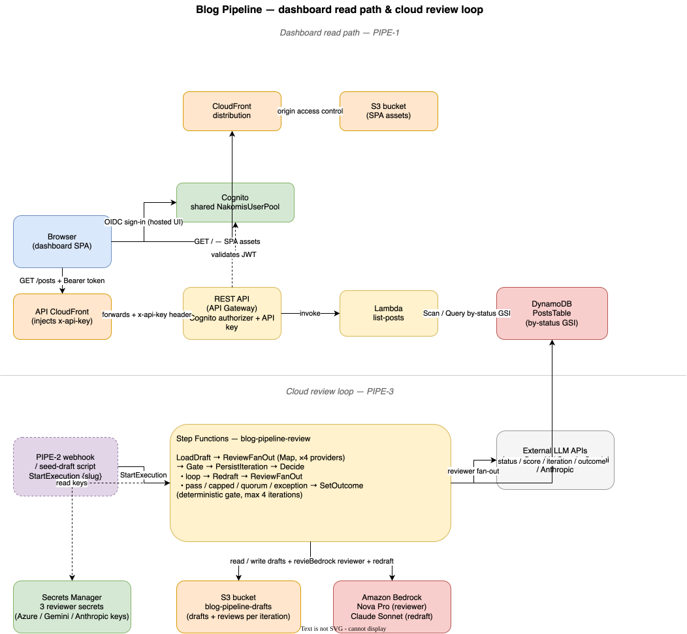

# Blog Pipeline — Cloud-native blog content review pipeline with a web UI

<p align="center">
  
</p>

## Support

If you find this useful, please consider buying me a coffee:

[](https://www.paypal.com/donate?hosted_button_id=Q3BESC73EWVNN&custom=blog-pipeline)

## Table of Contents

<!-- toc -->

- [Overview](#overview)
- [Architecture Diagram](#architecture-diagram)
- [Repository Layout](#repository-layout)
- [Environments](#environments)
- [Project status](#project-status)
- [Review loop](#review-loop)
  * [Link and repo suggestions (PIPE-38)](#link-and-repo-suggestions-pipe-38)
  * [Affiliate link step (PIPE-41)](#affiliate-link-step-pipe-41)
  * [Manual prerequisites](#manual-prerequisites)
  * [Image generation (PIPE-6)](#image-generation-pipe-6)
  * [fal.ai credit warning (PIPE-34)](#falai-credit-warning-pipe-34)
  * [Sandbox dry-run](#sandbox-dry-run)
- [Frontmatter panel (PIPE-37)](#frontmatter-panel-pipe-37)
- [Trigger](#trigger)
  * [Manual prerequisite](#manual-prerequisite)
- [First deployment](#first-deployment)
- [Architecture Diagrams](#architecture-diagrams)
- [Support](#support)

<!-- tocstop -->

## Overview

Blog Pipeline is a cloud-native review pipeline for [blog.nakom.is](https://blog.nakom.is)
content. A push of a Markdown post to the `blog-content` repo triggers a multi-model
review loop: several LLM reviewers score the draft for publishability, a deterministic
gate decides whether to iterate, and Claude Sonnet re-drafts against the critique — up
to four rounds. Generated images, the proposed revision and the reviewer critiques land
in a staging queue ("the bag") for a final human review before publication.

The web UI shows every post by pipeline stage.

## Architecture Diagram



## Repository Layout

| Directory | Contents |
|---|---|
| `web/` | React + Vite single-page app — the pipeline dashboard and approval UI |
| `infra/` | AWS CDK — API Gateway, Lambda, DynamoDB, Step Functions, CloudFront, Cognito |
| `docs/architecture/` | draw.io diagram source and generated SVGs |

## Environments

| Environment | Domain | AWS account |
|---|---|---|
| Sandbox | `pipeline.blog.sandbox.nakomis.com` | `975050268859` |
| Production | `pipeline.blog.nakomis.com` | `637423226886` |

## Project status

Work is tracked in Taiga under the **PIPE** prefix —
[taiga.nakom.is/project/blog-pipeline](http://taiga.nakom.is/project/blog-pipeline/).

| Story | Feature |
|---|---|
| PIPE-1 | Post dashboard — pipeline stage overview |
| PIPE-2 | Review trigger — GitHub Actions OIDC on blog-content push |
| PIPE-3 | Cloud review loop — Step Functions scored fan-out |
| PIPE-4 | The bag — staging queue and approval UI |
| PIPE-5 | Publish — commit to blog-content with optional schedule |
| PIPE-6 | FLUX image generation for posts |
| PIPE-7 | Cognito managed-login branding for the dashboard |

**PIPE-1 is implemented:** the dashboard read path is live — a React + Vite SPA
served from CloudFront, gated behind the shared Cognito user pool, listing every
post by pipeline stage from a REST API (`GET /posts`) backed by Lambda and
DynamoDB. The API has its own custom domain
(`api.pipeline.blog.[sandbox.]nakomis.com`) behind a CloudFront distribution that
injects the required API key, so the usage plan and quota are enforced without
exposing the key to the browser.

**PIPE-3 is implemented:** the cloud review loop — a Step Functions state machine
(`blog-pipeline-review`) that fans a draft out to four LLM reviewers in parallel,
scores it through a deterministic gate, and has Claude Sonnet re-draft against the
critique, up to four iterations. See [Review loop](#review-loop) below.

**PIPE-2 is implemented:** the review trigger — a GitHub Actions workflow in
`nakomis/blog-content` assumes an OIDC-trusted IAM role
(`blog-pipeline-trigger-{env}`) on every push to `main` touching `blog/*.md`,
and queues each changed post into the pipeline by writing the draft to S3,
the row to DynamoDB and starting a state-machine execution — all over IAM,
with no public endpoint anywhere. See [Trigger](#trigger) below. The remaining
stories (the staging queue, publishing) are built on top of these, story by
story.

To populate the dashboard before the review loop exists, seed sample data:

```bash
cd infra && AWS_PROFILE=nakom.is-sandbox npm run seed-sandbox
```

The SPA reads its runtime config from `/config.json`; generate it before a local
run or a deploy with `web/scripts/set-config.sh [sandbox|prod|localhost]`.

## Review loop

The review loop (PIPE-3) is an AWS Step Functions state machine,
`blog-pipeline-review-{env}`. Given a post `slug`, it:

1. **LoadDraft** — checks the post item and its iteration-1 draft exist, marks
   the post `reviewing`.
2. **ReviewFanOut** — a `Map` state fans the draft out to four LLM reviewers in
   parallel: GPT-5 and Grok-4, both on Azure AI Foundry, Google Gemini, and
   Anthropic Claude Opus. Each returns a structured verdict — a
   publishability score and any blockers — via the Vercel AI SDK with a Zod
   schema. A reviewer that errors is recorded as `unavailable` rather than
   failing the run. (The Bedrock provider code is kept in the repo for possible
   future re-inclusion, but is not currently fanned out — see the comment in
   `lib/config.ts` for the rationale.)
3. **Gate** — a deterministic, no-LLM decision: it needs a quorum of three of
   the four reviewers to have returned a verdict, every verdict at or above the
   publishability threshold, and no blockers.
4. **Decide** — pass → `staged`; below threshold → **Redraft** (Claude Sonnet on
   Bedrock rewrites against the critique) and loop, capped at four iterations.
5. **SetOutcome** — terminal: the post lands `staged` on a pass, or `failed`
   with a `reviewOutcome` of `capped`, `quorum`, or `exception`.

Drafts and per-iteration reviewer results are stored in the
`blog-pipeline-drafts-{env}` S3 bucket.

### Editing and re-reviewing a failed post (PIPE-36)

A `failed` post — whether the loop gave up or it was rejected in the bag — can
be fixed in place from its detail page. **Edit** opens the latest draft in a
text editor; **Save** writes it as the next draft iteration and leaves the post
`failed` (saving again overwrites that same iteration); **Re-review** saves the
editor's contents and restarts the review loop from that iteration, moving the
post back to `reviewing`.

| Route | Purpose |
|---|---|
| `GET /posts/{slug}/markdown` | the Markdown to edit — the saved edit if any, else the latest draft |
| `POST /posts/{slug}/markdown` | save an edit (`{"markdown": "…"}`) |
| `POST /posts/{slug}/rereview` | optionally save (`{"markdown": "…"}`), then re-review |

All three answer `409` unless the post is `failed`, and carry the same Cognito +
API-key protection as the other bag actions. A re-review clears the post's
`reviewOutcome` / `reviewError` but first appends them to `failureHistory`,
which the bag shows as "Previous failures". The re-trigger is idempotent: a
retry of a re-review that has already started returns `200` with
`alreadyStarted: true`, and the Step Functions execution is named
`rereview-{slug}-{iteration}`, so it cannot start twice.

### Link and repo suggestions (PIPE-38)

When the review loop passes, a separate best-effort state, `SuggestLinks`, runs
before the post is staged. It proposes links from the post to earlier posts, and
public GitHub repos the post names for its `repos:` frontmatter. Nothing is
applied silently: Martin accepts or rejects each in the bag, and only accepted
ones are written when he approves.

```
DecideLoop --pass--> SuggestLinks --(success, error or timeout)--> SetOutcomePass
```

- **Candidates come from code.** The draft is cut into ~700-character windows,
  embedded with Titan Embed Text v2 and compared with the blog's existing index,
  `blog-embeddings.json` in the `nakom.is` private bucket (written by
  `blog-app/scripts/ingest-blog.py`, so it holds published posts only). Only
  posts dated on or before this one are eligible, never the post itself. The
  top 8 above `LINKS.retrieval.floor` go to the model; if fewer than 3 clear it,
  the whole eligible catalogue is offered instead.
- **Haiku only chooses.** `claude-haiku-5-5`, through the direct Anthropic API
  with the reviewer's key (`/blog-pipeline/{env}/reviewer/anthropic`; AWS refuses
  Haiku 5.5 on Bedrock for these accounts), picks from those lists and never
  writes a URL. The prompt insists on a genuine reference
  to the earlier post's subject and prefers no suggestion to a doubtful one.
- **Code validates.** An anchor must be 2 to 6 words, appear exactly once and sit
  outside headings, code, links, images and `{{...}}`; at most one link per
  target and per paragraph, and one per 300 words. A repo must be on the list of
  `nakomis` public, non-fork repos fetched from GitHub, be named in the post
  (its name, `owner/name` or a GitHub URL), not already be in `repos:`, and is
  re-checked as `private === false`.
- **Failure never blocks staging.** On any error the post is staged with no
  suggestions and the reason is recorded (`suggestionsSummary.skippedReason`,
  shown in the bag). Where the embeddings index is absent (the sandbox) the step
  reports `skipped: no-embeddings-index`.
- **Storage.** `{slug}/iteration-{n}/suggestions.json` in the drafts bucket, with
  a small `suggestionsSummary` on the post row. `GET /posts/{slug}` returns it as
  `suggestions`; `POST /posts/{slug}/suggestions` (`{"decisions": {"<id>":
  "accepted" | "rejected" | "pending"}}`) records choices on a staged post.
- **On approval.** Accepted links are written into the final draft in place
  (S3 `If-Match`, one retry), so `promote-approved` commits them with the refined
  body. Accepted repos are stored on the row as `approvedRepos`; `promote-approved.py`
  in `blog-content` merges them into the author's `repos:` list. Undecided
  suggestions are ignored, with a warning in the bag.

Prerequisites: Titan Embed v2 enabled in Bedrock (us-east-1) in each account;
the Anthropic reviewer key parameter populated (the step reads the same one as
the Opus reviewer); and, for real suggestions, the embeddings index present in
`nakom.is-private[-sandbox]`. The suggest-links role can read only that one
parameter and the one embeddings object, and invoke only Titan on Bedrock.

`infra/scripts/link-suggestions-eval.ts` (`npm run eval-links-prod -- <post.md>
[--floor n] [--model id] [--watch slug-fragment] [--forbid slug-fragment]
[--also-catalogue]`) dry-runs the step against a real post, read-only, to
calibrate the floor and check for false positives. The known false-positive
check, which must pass in both retrieval mode and catalogue-fallback mode (the
second run forces the floor to 0.99 so the model is offered every post), is:

```bash
AWS_PROFILE=nakom.is-admin npm run eval-links-prod -- \
  ~/repos/nakomis/blog-content/blog/2026-10-10-alexa-announce-hello-world.md \
  --forbid three-of-them --also-catalogue
```

It exits 2 if the Alexa announce post is offered a link to the Cabal post.

### Affiliate link step (PIPE-41)

A separate, manual step in the bag for Amazon Associates links. The model never
writes or edits a link or a tag; it only points at words.

- **Detection.** The suggest-links Lambda makes a second, sibling Haiku call
  (same model and key) that returns product mentions: specific physical
  products Martin bought or used, each with the exact sentence it sits in.
  Code keeps a mention only if that sentence occurs exactly once in the post,
  the anchor is inside it, and the anchor is not in a heading, code, link,
  image or `{{...}}`. It runs even when the link half is skipped (no embeddings
  index) or fails. Results go in the same `suggestions.json` under
  `affiliates` (`affiliatesStatus`, `affiliatesReason`, `trackingId`).
- **The bag.** An "Affiliate links" tab after Article: the post with each
  mention highlighted and a row per mention. Paste the full amazon.co.uk
  SiteStripe link and press Enter (saves, moves to the next); Shift+Enter
  skips; Esc clears; "Skip all remaining" skips the rest. If the source file
  has no `amazon_tracking_id`, a per-post ID (`nakomis-<name>-21`) can be typed
  there; it is never invented.
- **Validation** (`lambda/suggest/affiliate.ts`, server side, no network): https,
  host `amazon.co.uk` or `www.amazon.co.uk`, exactly one `tag` that is
  `nakomis-21` or `nakomis-...-21`. Short links (`amzn.to`, `link.amazon`,
  `amzn.eu`, `a.co`) are rejected with "use SiteStripe's Full link", because the
  tag is hidden and the blog build refuses them. A tag that differs from the
  post's tracking ID, a missing tracking ID, a non-product page and a repeated
  product are warnings. The pasted text itself must also match a plain ASCII form
  (`AFFILIATE.rawPattern`: lower case, no port or sign-in details, no backslashes,
  quotes, brackets or whitespace), so URL tidying cannot let through a link that promotion would
  read differently. At approval the same product pasted twice is linked once (the
  first). The link is stored and later written exactly as pasted.
- **Route.** `POST /posts/{slug}/affiliates`
  (`{decisions: {id: {action: 'link', url} | {action: 'skip'} | {action: 'reset'}}, skipRemaining?, trackingId?}`),
  staged posts only.
- **On approval** the pasted links go into the final draft in the same `If-Match`
  write as accepted PIPE-38 links. Undecided mentions and a missing tracking ID
  produce warnings, never a refusal. The row gets `approvedAffiliateUrls` and,
  when the source has no tracking ID, `approvedTrackingId`.
- **Prerequisite (blog-content).** `promote-approved.py` must allow the links
  approved in the bag and add a typed tracking ID
  (`scripts/frontmatter_amazon.py`). Without that change promotion rejects a post
  whose approved body contains an Amazon link the author did not write (BAPP-16).
  It must be live before the first approval that contains an affiliate link.
- `npm run eval-links-prod -- <post.md> --products-only` runs just the product
  pass, read-only.

### Manual prerequisites

All four reviewers need API keys. `BlogPipelineReviewStack` creates four SSM
`String` parameters (cheaper at this scale than Secrets Manager) with a
placeholder value — overwrite each one after the first deploy, before running
the loop. The redrafter still runs on Bedrock (Claude Sonnet via the EU
cross-region inference profile), so the Sonnet model must be enabled in the
account's Bedrock model access page.

> ⚠️ **Order matters: deploy first, populate second.** CloudFormation will only
> *create* the SSM parameters — it has no way to adopt a pre-existing one. If
> you run `aws ssm put-parameter` for `/blog-pipeline/{env}/reviewer/<provider>`
> before the first `cdk deploy` of that environment, the next deploy will fail
> with `Resource of type 'AWS::SSM::Parameter' with identifier '…' already
> exists.` The recovery is to `aws ssm delete-parameter`, redeploy so CFN
> creates the placeholder, then `put-parameter --overwrite` to put the real
> value back. Avoid the round-trip by deploying first.

| Parameter | JSON shape |
|---|---|
| `/blog-pipeline/{env}/reviewer/azure` | `{"apiKey","endpoint","deployment","apiVersion"}` |
| `/blog-pipeline/{env}/reviewer/gemini` | `{"apiKey"}` |
| `/blog-pipeline/{env}/reviewer/anthropic` | `{"apiKey"}` |
| `/blog-pipeline/{env}/reviewer/grok` | `{"apiKey","endpoint","deployment","apiVersion"}` |

Both `azure` and `grok` target the Azure AI Foundry
`/models/chat/completions` endpoint and share the same JSON shape: `endpoint`
is the full Foundry hostname (e.g. `https://<instance>.services.ai.azure.com`),
`deployment` is the Foundry deployment name (e.g. `gpt-5` or `grok-4.3`), and
`apiVersion` is the Foundry inference API version (e.g. `2024-05-01-preview`).
The `azure` GPT model is a reasoning model, so it goes through Foundry's
OpenAI-compatible surface rather than the classic `…openai.azure.com` one,
which the AI SDK routes through an unsupported API version for these models.

```bash
aws ssm put-parameter \
  --profile nakom.is-sandbox \
  --name /blog-pipeline/sandbox/reviewer/gemini \
  --type String --overwrite \
  --value '{"apiKey":"…"}'

aws ssm put-parameter \
  --profile nakom.is-sandbox \
  --name /blog-pipeline/sandbox/reviewer/grok \
  --type String --overwrite \
  --value '{"apiKey":"…","endpoint":"https://<instance>.services.ai.azure.com","deployment":"grok-4.3","apiVersion":"2024-05-01-preview"}'
```

CloudFormation does not reconcile drift on subsequent deploys, so a manually
overwritten value survives. The keys live in plain (unencrypted) parameters
— acceptable here because the parameter prefix is locked down by IAM to the
reviewer Lambda role; harden to `SecureString` out of band if that trade-off
ever changes.

If a parameter is left at its placeholder that reviewer simply reports
`unavailable`; the loop still runs as long as the three-reviewer quorum is met.

### Image generation (PIPE-6)

A post can mark where illustrations belong with `{{image}}` placeholders, e.g.
`{{image prompt="a black cat asleep on a warm radiator"}}`. At loop entry
`load-draft` fires the `image-submit` Lambda (fire-and-forget), which queues a
fal.ai FLUX job per placeholder concurrently with the review. fal calls the
public `POST /image-callback` route back when each image is ready; the handler
verifies fal's ED25519 signature, stores the PNG in the drafts bucket, and —
once the post has left review — rewrites the placeholder into a Markdown image
reference. Image generation is best-effort: a failure never blocks the review.

The fal API key lives in a single plain `String` parameter, populated by hand
after the first deploy (same deploy-before-populate pattern as the reviewer
keys). Unlike the reviewer parameters it is the raw key, not JSON:

```bash
aws ssm put-parameter \
  --profile nakom.is-sandbox \
  --name /blog-pipeline/sandbox/image/fal \
  --type String --overwrite \
  --value "$(security find-generic-password -s fal.ai -a api-key -w)"
```

Left at its placeholder, `image-submit` fails to read the key and submits no
jobs — the post is still reviewed and published, just without illustrations.

### fal.ai credit warning (PIPE-34)

fal locks the account and rejects every generation once its prepaid balance
runs out, so `image-submit` runs a pre-flight credit check before submitting.
When the remaining credit drops below **$5** it publishes a warning to the
failure-alerts SNS topic (`blog-pipeline-alerts-{env}`, PIPE-15) at most once
per UTC day, and the dashboard shows a banner. The check only ever warns: low
credit, or a failed check, never stops or changes a generation.

The remaining credit comes from fal's account-billing API
(`GET https://api.fal.ai/v1/account/billing?expand=credits`) when an **admin**
key is configured — fal refuses that endpoint to ordinary inference keys. The
admin key goes in its own optional parameter:

```bash
aws ssm put-parameter \
  --profile nakom.is-sandbox \
  --name /blog-pipeline/sandbox/image/fal-admin \
  --type String --overwrite \
  --value "<fal ADMIN key>"
```

Without it (or if the call fails) the check falls back to an estimate: a
monthly budget less this month's generation count × an estimated cost per
image. The defaults live in `IMAGE.credit` in `lib/config.ts` and reach the
Lambda as env vars — `FAL_CREDIT_WARN_THRESHOLD_USD` (5),
`FAL_MONTHLY_BUDGET_USD` (25) and `FAL_COST_PER_IMAGE_USD` (0.06).

The generation count, the last-warned date and the latest snapshot (served to
the dashboard by `GET /image-credit`) are kept as JSON in
`/blog-pipeline/{env}/image/fal-credit-state`, written by the Lambda.

### Sandbox dry-run

In prod the trigger fires automatically (see [Trigger](#trigger)); in sandbox
the trigger role exists but no workflow targets it, so the loop is exercised
by hand with a deliberately-imperfect seeded draft:

```bash
cd infra
AWS_PROFILE=nakom.is-sandbox npm run seed-draft-sandbox

aws stepfunctions start-execution \
  --profile nakom.is-sandbox \
  --state-machine-arn "$(aws ssm get-parameter \
    --profile nakom.is-sandbox \
    --name /blog-pipeline/sandbox/review/state-machine-arn \
    --query Parameter.Value --output text)" \
  --input '{"slug":"why-i-use-git-worktrees"}'
```

The seed script writes a `queued` post item and its iteration-1 draft to S3;
pass an alternative slug as an argument to `seed-draft.ts` to seed more than
one.

## Frontmatter panel (PIPE-37)

The bag's post view has a collapsible **Frontmatter** panel above the tabs. It shows
every field of the author's frontmatter (the iteration-1 draft, which is what
promotion keeps), the unknown fields, and the raw YAML. It is collapsed unless
something needs a look. Warnings never block Approve or Reject:

- a required field (title, date, excerpt, tags, author, canonical) is missing or empty;
- `canonical` is not `<blog base URL>/<filename-without-.md>` (the base URL is
  `BLOG_BASE_URL` in `infra/lib/config.ts`);
- `date` does not match the filename's date prefix;
- `approved` is set in the source but the post has not been approved in this review round;
- the staged version's frontmatter differs from the author's (promotion keeps the author's);
- a `repos:` URL is private or 404s on GitHub.

The filename comes from the `sourceFile` attribute that blog-content's `queue-posts.py`
writes to the posts table. Older items without it fall back to the filename implied by
`canonical`, or skip the two filename checks. The repository check is
`GET /posts/{slug}/repo-checks`: it reads the `repos:` list from the draft itself, checks
`github.com` URLs live through the GitHub API (using the existing dispatch token for the
rate limit if it is set) and shows other hosts without checking them.

## Trigger

A push to `nakomis/blog-content`'s `main` branch that touches `blog/*.md`
runs a GitHub Actions workflow (`.github/workflows/trigger-review.yml` in
that repo). The workflow assumes the `blog-pipeline-trigger-prod` IAM role
via OIDC — no static credentials, no public endpoint, no shared secret —
and for each added or modified post does three AWS API calls directly:

1. `s3:PutObject` → `s3://blog-pipeline-drafts-prod/{slug}/iteration-1/draft.md`
2. `dynamodb:PutItem` on the posts table (`queued`, with a `ConditionExpression`
   so a still-in-flight review isn't double-queued)
3. `states:StartExecution` on `blog-pipeline-review-prod` with `{"slug":"…"}`

The slug is the filename's date prefix stripped — `blog/2026-05-22-my-post.md`
queues as `my-post`. Deleted files are ignored.

The role is created by `BlogPipelineTriggerStack` in both environments for
parity; only prod is currently wired to a workflow. Sandbox is exercised via
the `seed-draft` script above. To switch the workflow to sandbox temporarily,
change the four `env:` values in `trigger-review.yml` to the sandbox role
ARN, bucket name, table name and state-machine ARN.

### Manual prerequisite

The role ARN must be pasted into the workflow's `env:` block after the first
deploy. After that, every subsequent deploy is fully automated:

```bash
aws ssm get-parameter \
  --profile nakom.is-admin \
  --name /blog-pipeline/prod/trigger/role-arn \
  --query Parameter.Value --output text
```

## First deployment

There is one unavoidable manual step before CI can take over.

The GitHub Actions deploy role is itself created by CDK — it is the `GithubCiStack`.
So the *first* deployment cannot run through CI: there is no role for the workflow
to assume yet. Something holding AWS credentials has to create that role, and with
no separate repo-bootstrapping tooling, that something is a human at a workstation.

Both regions must be CDK-bootstrapped first (the CloudFront certificates live in
`us-east-1`):

```bash
npx cdk bootstrap aws://975050268859/eu-west-2 aws://975050268859/us-east-1
```

Then deploy everything once, per account. `cdk deploy --all` orders the stacks by
dependency — `WebCert` (us-east-1) → `BlogPipeline` → `Api` → `Web` → `GithubCi`:

```bash
cd infra

# Sandbox
AWS_PROFILE=nakom.is-sandbox NPM_ENVIRONMENT=sandbox npx cdk deploy --all

# Production — when ready to go live
AWS_PROFILE=nakom.is-admin NPM_ENVIRONMENT=prod npx cdk deploy --all
```

Once the CI role exists, every subsequent push deploys itself: the workflow assumes
the role and runs `cdk deploy`. The manual step is never needed again unless the CI
stack is torn down.

`cdk.context.json` is intentionally gitignored. A local deploy generates it from
account lookups and it stays on your machine; CI regenerates its own.

## Architecture Diagrams

`docs/architecture/blog-pipeline.drawio` is the source for the diagram above.
The SVG is auto-regenerated on commit by the pre-commit hook in `.githooks/pre-commit`.

To activate the hook after cloning:

```bash
git config core.hooksPath .githooks
```

## Support

If you find this useful, please consider buying me a coffee:

[](https://www.paypal.com/donate?hosted_button_id=Q3BESC73EWVNN&custom=blog-pipeline)
